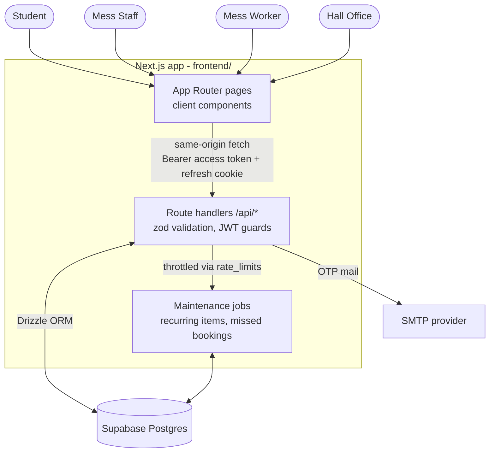

# Hall 12 - Hall Management Portal (HMP)

## Why this is open source

This portal is built in the open for two reasons:

- **Residents can build the features they want.** Anyone living in the hall can open an issue, pick one up, or send a pull request. The whole app is one Next.js project with a documented API (see [`frontend/docs/api/`](frontend/docs/api/README.md)), so a new contributor can add a page or an endpoint without learning a second stack.
- **Other halls can run their own copy.** Fork it, change the hall name, logo and a few settings, point it at your own Supabase project and Vercel account, and you have a working mess portal. Nothing in the code is tied to Hall 12 beyond branding and the institute email domain.

Contributions of any size are welcome: bug reports, copy fixes, new features, or a hall-specific fork that others can learn from.

## What it does

Hall Management Portal for IIT Kanpur Hall of Residence XII (Marathas). Students browse and book paid food extras, mess workers mark them served (QR scanning or a manual queue), and mess staff manage extras, the weekly menu, daily wastage figures, notices and CSV reports. The hall office onboards students in bulk and manages staff accounts.

The app is a single **Next.js full-stack project** in [`frontend/`](frontend/): the UI and the API (route handlers under `/api`) deploy together on Vercel and talk to a Supabase Postgres database.

> The previous Next.js + FastAPI version is preserved on the `next+fastapi-version` branch. Its `backend/` folder is gitignored on `main` and is no longer deployed or required.

## Tech Stack

| Layer | Technology |
|---|---|
| App | Next.js 16 (App Router, route handlers), React 19, TypeScript, Tailwind CSS 4 |
| Database | PostgreSQL (Supabase, transaction pooler) via Drizzle ORM + postgres.js |
| Auth | JWT (HS256, `jose`) access tokens in memory + httpOnly refresh cookie, bcrypt (`bcryptjs`) |
| Validation | zod |
| Email | nodemailer (SMTP STARTTLS; console fallback in dev) |
| QR | `qrcode` for generation, `html5-qrcode` for scanning (behind feature flags) |
| Jobs | No scheduler: maintenance runs lazily (throttled) inside the read endpoints that need it |
| Hosting | Vercel Hobby (root directory `frontend`) |

## Architecture



Every former FastAPI endpoint exists at the same path with an `/api` prefix. The per-endpoint reference lives in [`frontend/docs/api/`](frontend/docs/api/README.md).

## Quick Start

### Prerequisites

- Node.js 20+ (22 recommended)
- A Postgres database (Supabase project, or any local Postgres)

### 1. Install and configure

```bash
cd frontend
npm install
cp .env.example .env.local
# Fill in DATABASE_URL (Supabase pooler URL, port 6543) and JWT_SECRET.
# Leave SMTP_HOST/SMTP_USER empty to print OTP emails to the console.
```

### 2. Database

**Existing Supabase database (migrated from the FastAPI version):** the tables already exist. Run the one-off script in the Supabase SQL editor to add the only new table:

```
frontend/drizzle/manual/add_rate_limits_to_existing_db.sql
```

**Every Supabase project (existing or fresh):** also run `frontend/drizzle/manual/harden_supabase_data_api.sql` once in the SQL editor. It enables row level security and revokes the `anon` / `authenticated` grants so the Supabase REST API cannot read or write the app tables; the app's own `postgres` connection is unaffected.

**Fresh database:**

```bash
npm run db:migrate   # applies frontend/drizzle/*.sql
npm run db:seed      # creates the hall_office admin (admin@hall12 / SEED_ADMIN_PASSWORD or Hall12kaAdmin!)
```

### 3. Run

```bash
npm run dev          # http://localhost:3000
npm run typecheck    # next typegen + tsc
npm run lint
npm test             # vitest (auth, schemas, csv, dates)
npm run build
```

### 4. First login

Use the seeded hall_office admin (`admin@hall12`). You must change the password on first login. Then upload the student roll CSV, download setup codes, and create mess staff / worker accounts.

## Deploying to Vercel (Hobby)

1. Import the repository, set **Root Directory** to `frontend`.
2. Add every variable from `frontend/.env.example` in Project Settings -> Environment Variables (`COOKIE_SECURE=true`).
3. No cron or scheduler is needed: recurring-item clones and missed-booking marking run lazily when the relevant pages are opened, throttled through the database.
4. Keep the Supabase project awake (free projects pause after a week of inactivity).

Invocation budget: a hard page load costs one API call (`/api/auth/refresh` returns the user), there is no keep-alive ping, and in-app navigation is client-side, so ~700 daily users stay well inside the Hobby limits.

## Roles

| Role | Access |
|---|---|
| `hall_office` | Upload roll numbers CSV, download setup codes, create/deactivate staff accounts, post notices |
| `mess_staff` | Manage extras items, view/serve/cancel bookings, approve cancellation requests, edit weekly menu, enter wastage, post notices, download CSV reports |
| `mess_worker` | QR scanner (when enabled), today's booking queue |
| `student` | Dashboard (wastage, menu, notices), browse/book extras, booking history, change password |

## Project Structure

```
HMP/
├── frontend/                      # the whole application
│   ├── src/app/                   # pages (client components) + api/**/route.ts handlers
│   ├── src/lib/server/            # server-only code
│   │   ├── db/schema.ts           # Drizzle schema (1:1 with the Postgres tables)
│   │   ├── db/client.ts           # postgres.js pool (serverless-safe singleton)
│   │   ├── auth/                  # jwt, password hashing, cookies, guards, session
│   │   ├── schemas/               # zod request schemas (former Pydantic models)
│   │   ├── jobs/                  # recurring items, missed bookings, maintenance runner
│   │   ├── http.ts                # FastAPI-style error contract, handleRoute wrapper
│   │   ├── rate-limit.ts          # Postgres-backed rate limits and job throttle
│   │   ├── email.ts, qr.ts, csv.ts, dates.ts, serializers.ts
│   │   └── __tests__/             # vitest unit tests
│   ├── src/lib/                   # api client, auth context, utils (client side)
│   ├── drizzle/                   # SQL migrations + manual script for the existing DB
│   ├── scripts/seed.ts            # bootstrap admin account
│   └── docs/api/                  # one Markdown file per endpoint
├── backend/                       # (gitignored) legacy FastAPI service, kept on branch next+fastapi-version
├── README.md
└── SECURITY.md
```

## Notes

- **Timestamps** are stored as naive UTC and returned as ISO strings with `Z`; business dates (today, meal cutoffs, wastage) use India time.
- **Rate limiting** lives in the `rate_limits` table (OTP 3/15 min, login 5/15 min, setup codes 10/15 min), so it works across serverless instances.
- **QR flow** is disabled by default (`QR_SCANNING_ENABLED` / `NEXT_PUBLIC_QR_SCANNING_ENABLED`); workers use the manual queue.
- **Email in dev:** OTPs are printed to the server console unless `SMTP_HOST` and `SMTP_USER` are set.
